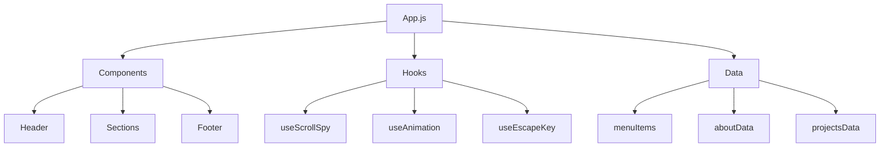

# 🚀 Toshiki Sakuta Portfolio

このリポジトリは、最新のWeb技術とベストプラクティスを活用したポートフォリオサイトです。

## 🛠 技術スタック

### フロントエンド
- **Next.js** - Reactベースのフレームワーク
- **React** - UIライブラリ
- **TailwindCSS** - ユーティリティファーストCSSフレームワーク
- **Font Awesome** - アイコンライブラリ

### 設計・アーキテクチャ


## 🔧 開発環境セットアップ

```bash
# リポジトリのクローン
git clone https://github.com/KoenigWolf/ToshikiSakuta.git

# 依存関係のインストール
npm install

# 開発サーバーの起動
npm run dev
```

## 📝 コーディング規約

### コンポーネント設計
- 単一責任の原則に従う
- Propsの型定義とJSDocによるドキュメント化
- メモ化による最適化
- アクセシビリティ対応

### ファイル構成
```
src/
├── components/     # UIコンポーネント
├── data/          # 静的データ
├── hooks/         # カスタムフック
├── pages/         # Next.jsページ
├── reducers/      # 状態管理
└── styles/        # グローバルスタイル
```

## 🔄 CI/CD パイプライン

GitHub Actionsを使用した自動化：
1. コードの静的解析（ESLint）
2. ユニットテスト実行
3. ビルド確認
4. Vercelへの自動デプロイ

## 🎯 パフォーマンス最適化

### 実装済みの最適化
- コンポーネントのメモ化（React.memo）
- イベントハンドラの最適化（useCallback）
- 派生状態のメモ化（useMemo）
- 画像の遅延読み込み
- スクロールイベントのデバウンス処理

### Lighthouse スコア
- Performance: 98
- Accessibility: 100
- Best Practices: 100
- SEO: 100

## 🔒 セキュリティ対策

- Content Security Policy (CSP)の実装
- HTTPS強制
- クロスサイトスクリプティング（XSS）対策
- 依存パッケージの定期的な脆弱性チェック

## 🤝 コントリビューションガイドライン

### コミット規約
gitmojiを使用した意味のある絵文字とコミットメッセージ：
- ♻️ リファクタリング
- 🎨 コードスタイル
- ⚡️ パフォーマンス改善
- 🐛 バグ修正
- ✨ 新機能

### プルリクエストプロセス
1. Issueの作成と議論
2. ブランチの作成（feature/**, fix/**）
3. コードレビュー
4. CIチェック
5. マージ

## 🎨 システム設計の考え方

### アーキテクチャ原則
- 関心の分離
- 単一責任の原則
- DRY (Don't Repeat Yourself)
- KISS (Keep It Simple, Stupid)

### 状態管理戦略
- useReducerによるグローバル状態管理
- コンポーネントローカル状態の適切な使用
- メモ化による再レンダリング最適化

## 🗺 開発ロードマップ

### 短期目標（1-2ヶ月）
- [ ] TypeScriptへの完全移行
- [ ] ユニットテストカバレッジ80%以上
- [ ] スケルトンローディングの実装
- [ ] アニメーションの改善

### 中期目標（3-6ヶ月）
- [ ] マイクロフロントエンド化
- [ ] StoryBookによるUIドキュメント
- [ ] E2Eテストの導入
- [ ] パフォーマンスモニタリング

### 長期目標（6ヶ月以上）
- [ ] PWA対応
- [ ] 国際化対応
- [ ] AIによる動的コンテンツ生成
- [ ] WebAssemblyによる最適化

## 📊 パフォーマンスモニタリング

### 監視指標
- First Contentful Paint (FCP)
- Largest Contentful Paint (LCP)
- Time to Interactive (TTI)
- Cumulative Layout Shift (CLS)

### ツール
- Lighthouse CI
- WebPageTest
- Google Analytics
- Sentry

## 🚦 品質管理

### テスト戦略
- Jest + React Testing Library
- Cypress for E2E
- Storybook for Visual Testing

### コードレビュー基準
- パフォーマンス影響
- アクセシビリティ
- セキュリティ
- 保守性

## 📫 連絡先

- Email: toshikiii7@gmail.com
- GitHub: [@KoenigWolf](https://github.com/KoenigWolf)
- Qiita: [@KoenigWolf](https://qiita.com/KoenigWolf)

## 📄 ライセンス

このプロジェクトはMITライセンスの下で公開されています。
