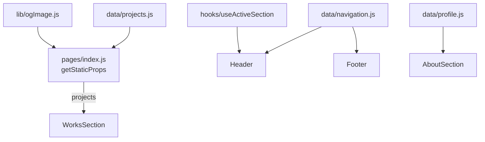

# 🚀 Toshiki Sakuta Portfolio

Next.js で構築したポートフォリオサイトです。

## 🛠 技術スタック

- **Next.js 16**（Pages Router / Turbopack / ISR）
- **React 18**
- **Tailwind CSS 3**
- **Font Awesome**（SVG アイコン）

## 🔧 開発環境セットアップ

Node.js 22.12 以上（推奨: `.nvmrc` の 24）が必要です。

```bash
git clone git@github.com:bright-broom/ToshikiSakuta.git
cd ToshikiSakuta
npm ci
npm run dev   # http://localhost:3000
```

| コマンド | 内容 |
| --- | --- |
| `npm run dev` | 開発サーバー（localhost のみで待ち受け） |
| `npm run build` | 本番ビルド |
| `npm start` | 本番サーバー |
| `npm test` | ユニットテスト（`node:test`） |
| `npm run security:audit` | 依存パッケージの脆弱性・署名検証 |

## 🏗 設計

### ディレクトリ構成

```
src/
├── pages/                  # ルーティング
│   ├── _app.js             # 共通フォント・スタイル
│   ├── _document.js        # <html lang="ja">
│   └── index.js            # トップページ（getStaticProps で制作実績の OG 画像を取得）
├── components/
│   ├── layout/             # Header / Footer
│   ├── sections/           # HomeSection / WorksSection / AboutSection
│   └── ui/                 # 複数箇所で使う小さな部品（SectionHeading / SocialLinks）
├── hooks/                  # useActiveSection / useEscapeKey
├── data/                   # 表示内容（ナビゲーション・プロフィール・制作実績）
├── lib/                    # サーバー側専用の処理（ogImage）
└── styles/                 # グローバル CSS
tests/                      # lib のユニットテスト
```

### データの流れ



- 表示内容は `src/data/` に集約し、コンポーネントは表示に専念します。
- 外部サイトへのアクセス（OG 画像の URL 取得）は `getStaticProps` でのみ行い、1 日ごとに再生成（ISR）します。
- ページ内の移動は `<a href="#id">` と CSS の `scroll-behavior` で実現し、現在のセクションはヘッダー内で判定します。

## 🔒 セキュリティ

詳細は [SECURITY.md](./SECURITY.md) を参照してください。セキュリティヘッダーは `next.config.js` で設定しています。

## 🤝 コミット規約

gitmoji を使用します。

- ♻️ リファクタリング
- 🎨 コードスタイル
- ⚡️ パフォーマンス改善
- 🐛 バグ修正
- ✨ 新機能
- 🔒 セキュリティ

## 📄 ライセンス

このプロジェクトはMITライセンスの下で公開されています。
