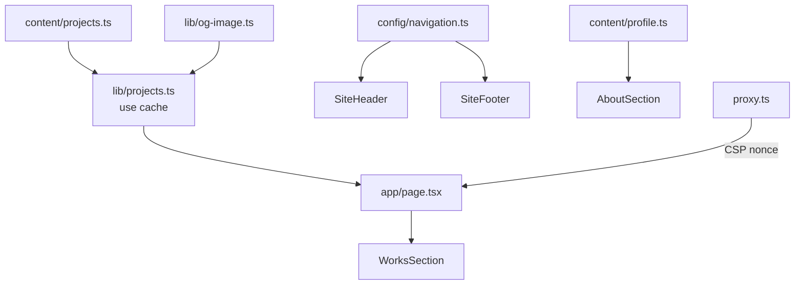

# Toshiki Sakuta Portfolio

Next.js（App Router）と TypeScript で構築したポートフォリオサイトです。

## 技術スタック

| 分類 | 採用技術 |
| --- | --- |
| フレームワーク | Next.js 16（App Router / Turbopack / Cache Components / React Compiler） |
| UI | React 19、Tailwind CSS 4、Font Awesome 7 |
| 言語 | TypeScript 6（strict） |
| 品質 | ESLint 9（flat config / eslint-config-next）、Node.js テストランナー |
| 実行環境 | Node.js 24 LTS（`.nvmrc`） |

TypeScript は 7 系が公開されていますが、ESLint の TypeScript 対応（typescript-eslint）が 6.1 未満までのため 6 系を使用しています。

## セットアップ

```bash
git clone git@github.com:bright-broom/ToshikiSakuta.git
cd ToshikiSakuta
nvm use          # Node.js 24
npm ci
npm run dev      # http://localhost:3000
```

| コマンド | 内容 |
| --- | --- |
| `npm run dev` | 開発サーバー（localhost のみで待ち受け） |
| `npm run build` | 本番ビルド |
| `npm start` | 本番サーバー |
| `npm run lint` | ESLint（警告も失敗扱い） |
| `npm run typecheck` | ルート型の生成と型チェック |
| `npm test` | ユニットテスト（`node:test`。TypeScript をそのまま実行） |
| `npm run check` | lint・型チェック・テストをまとめて実行 |
| `npm run security:audit` | 依存パッケージの脆弱性・署名検証 |

### 環境変数

| 変数 | 用途 | 既定値 |
| --- | --- | --- |
| `NEXT_PUBLIC_SITE_URL` | 公開 URL（metadataBase / sitemap / robots） | Vercel の本番ドメイン、なければ `http://localhost:3000` |

## 設計

### ディレクトリ構成

```
src/
├── app/                    # ルーティング（App Router）
│   ├── layout.tsx          # <html>、フォント、メタデータ
│   ├── page.tsx            # トップページ
│   ├── globals.css         # Tailwind CSS とデザイントークン（@theme）
│   ├── icon.svg / robots.ts / sitemap.ts
├── proxy.ts                # リクエストごとの CSP nonce 発行
├── components/
│   ├── layout/             # SiteHeader（Client）/ SiteFooter
│   ├── sections/           # HeroSection / WorksSection / AboutSection
│   ├── works/              # ProjectCard / ProjectImage（Client）
│   └── ui/                 # SectionHeading / SocialLinks
├── config/                 # 設定の一元管理
│   ├── site.ts             # サイト名・説明・外部リンク
│   ├── navigation.ts       # セクション id・ナビゲーション・SNS リンク
│   ├── security.ts         # CSP とセキュリティヘッダー
│   ├── og-image.ts         # OG 画像取得の制限値・キャッシュ期間
│   └── env.ts              # 環境変数の読み取りと検証
├── content/                # 表示する文言・データ
│   ├── copy.ts             # 見出し・ボタン・アクセシビリティ用ラベル
│   ├── profile.ts          # 自己紹介・スキル・経歴
│   └── projects.ts         # 制作実績
├── hooks/                  # useActiveSection / useEscapeKey
├── lib/                    # サーバー側の処理（og-image / projects）と Font Awesome 設定
└── types/                  # コンテンツの型定義
tests/                      # lib のユニットテスト
```

### 方針

- **Server Components を基本**とし、状態を持つヘッダーと画像のフォールバック処理だけを Client Component にしています。
- **ハードコーディングをしない**: 文言は `content/`、サイト情報・リンク・セキュリティ設定は `config/`、色とヘッダー高さは `globals.css` の `@theme` に集約しています。Tailwind の既定カラーパレットは無効化しているため、定義済みのトークン（`brand-*` など）以外の色は使えません。
- **データ取得**: 制作実績の OG 画像 URL は `lib/projects.ts` でサーバー側から取得し、`"use cache"` と `cacheLife` でキャッシュします。
- **レンダリング**: CSP の nonce をリクエストごとに発行するため、ページはリクエスト時にレンダリングします。OG 画像の取得結果はキャッシュされるため、リクエストごとに外部サイトへアクセスすることはありません。
- **最適化**: `useMemo` / `useCallback` / `memo` は使わず、React Compiler に任せています。

### データの流れ



## セキュリティ

[SECURITY.md](./SECURITY.md) を参照してください。

## コミット規約

[Conventional Commits](https://www.conventionalcommits.org/ja/v1.0.0/) に従います。絵文字は使用しません。

| 種別 | 用途 |
| --- | --- |
| `feat` | 新機能 |
| `fix` | バグ修正 |
| `refactor` | 挙動を変えないコード変更 |
| `perf` | パフォーマンス改善 |
| `style` | コードスタイル |
| `docs` | ドキュメント |
| `test` | テスト |
| `build` / `ci` | ビルド設定・依存パッケージ / CI |
| `chore` | その他 |

## ライセンス

このプロジェクトはMITライセンスの下で公開されています。
